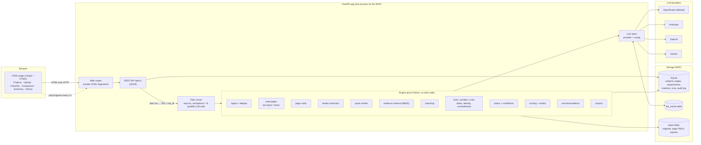
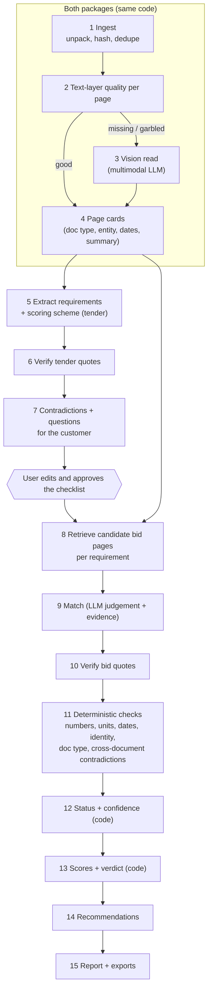
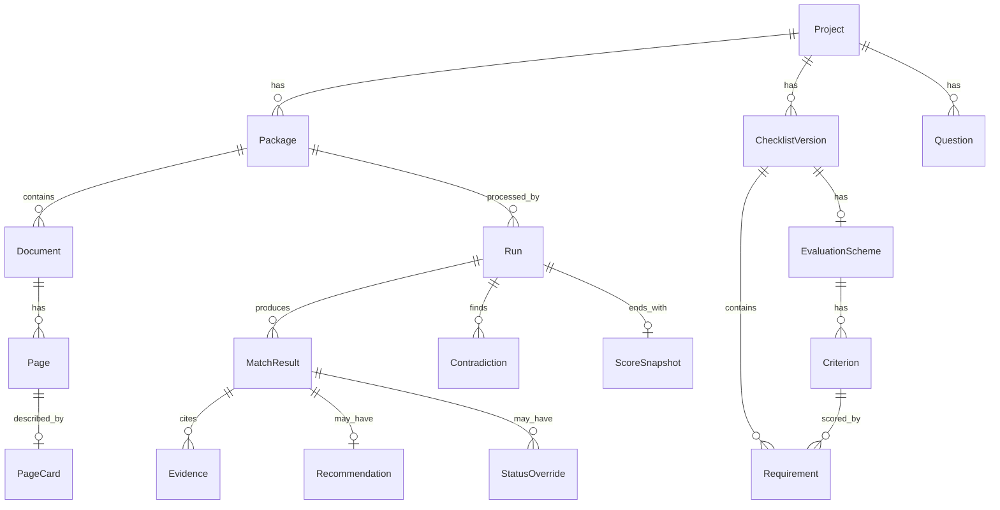

# Tender-Sverka: architecture (supplier side MVP)

Date: 2026-10-14 · Status: draft for approval · Scope: supplier mode (1 tender + 1 bid), designed so customer mode (1 tender + N bids) reuses the same engine.

Inputs used: [spec-en.md](spec-en.md) (the target product), [../lucius-supplier-side-research.md](../lucius-supplier-side-research.md) (how Lucius AI is built, what works and what fails), [research/analysis-supplier-opus.md](research/analysis-supplier-opus.md) (our analysis of that research), and the real test set in `test-data/gov-tender/` (surveyed, not processed). There is no existing code: stage 1 ("reading layer") is built from scratch as day 1 of this plan.

Tags used for Lucius evidence: **CONF** = observed in our test runs, **VENDOR** = Lucius says so, **INF** = our inference.

---

## 1. Summary

Tender-Sverka is one Python web application. The browser uploads the tender and the bid; the server answers at once with a run ID and processes the files in the background, while the page polls for progress and shows results as each stage finishes (the Lucius pattern: "202 + job ID, then poll"). Every page of every document is turned into text with a page number: born-digital pages use the PDF's own text, and scanned pages or pages with a broken text layer are sent as images to a multimodal LLM. The LLM is used only to **read and interpret**: it extracts tender requirements, describes bid pages, and judges whether a piece of bid evidence addresses a requirement. Everything that must be trusted is done **by code**: checking that every quote really exists on the cited page, comparing numbers and dates, choosing the status, computing the compliance % and the tender's own points, and deciding the verdict. For each requirement, code first selects the handful of bid pages most likely to hold the evidence, so the LLM never receives the whole bid. All LLM calls go through one client that can talk to OpenRouter, Anthropic, OpenAI or Gemini by config, and every call is cached by a hash of (model, prompt version, input), so the same files give the same result. For the MVP the data lives in SQLite plus a local folder; the production path (Postgres, S3, a task queue, pgvector) is the same code behind the same interfaces.

---

## 2. Options considered

All three options share the same Python engine (reading, extraction, matching, scoring). They differ in how the user interface is delivered.

| | A. FastAPI + separate React SPA | **B. FastAPI + server-rendered pages (Jinja2 + HTMX)** | C. Streamlit |
|---|---|---|---|
| What it is | JSON API in Python, a second app in TypeScript for the UI | One Python app. The server renders HTML; HTMX (a 14 KB script) swaps page fragments for live updates | Python script that renders widgets |
| Work for a solo dev in 5 days | Two codebases, two build tools, types duplicated | One codebase; the JSON API exists anyway for tests and later clients | Least code at first |
| Split-view comparison screen (spec §9) | Easy | Easy: two panels, clicking an item loads the right panel via HTMX | Awkward: limited layout control, whole script reruns on each click |
| Live progress, partial results | Easy | Easy: HTMX polls a fragment every 2 s | Possible but clunky |
| Path to production / other clients | Good | Good: the same REST API serves a future React app, TenderZone or TenderGPT | Poor: Streamlit is a prototyping tool, not a product UI |
| Risk | Time | Small learning curve for HTMX | Hitting its limits on day 4 |

**Decision: B.** It is the fastest way for one person to ship a usable split-view product, keeps everything in one language, and keeps a clean REST API so a React front end can replace the HTML pages later without touching the engine.

Inside B, the background work also had options:
- **Celery + RabbitMQ/Redis** (spec §11): a separate broker and worker processes. Too heavy for a local demo.
- **FastAPI `BackgroundTasks`**: too simple; no concurrency limit, no progress model.
- **Chosen: an in-process async task runner** (one `asyncio` task per run, a semaphore limiting parallel LLM calls), with every stage writing its result to the database. If the app restarts, re-running the run skips finished stages and re-uses cached LLM answers, so nothing is paid twice. The runner sits behind a small interface (`enqueue(run_id)`), so it can be swapped for `arq` (Redis) or Celery later.

---

## 3. System diagram



Production path (not built now): SQLite → **PostgreSQL**; `data/` folder → **S3-compatible storage** (same `FileStore` interface); in-process runner → **arq or Celery with Redis**, with workers per page and per file; BM25 → BM25 **plus pgvector** embeddings if recall needs it. Lucius runs this exact shape on Google Cloud (Cloud Run, AlloyDB = Postgres with embeddings, GCS, a job queue) (VENDOR), which is evidence that it is enough for this product.

---

## 4. Processing pipeline

### 4.1 Overview



Two runs exist per project: the **tender run** (stages 1–7, ends at the approval gate) and the **bid run** (stages 1–4 on the bid, then 8–15). Customer mode is N bid runs against one approved checklist.

### 4.2 Stage by stage

For every stage: what goes in, what comes out, who does it, how it is cached, and how it fails safely. "Cached" means re-running with unchanged input costs nothing and gives the same output.

**Stage 1 — Ingest** (code)
- In: uploaded files (PDF, DOCX, XLSX, JPG/PNG/TIFF, ZIP, RAR).
- Work: unpack archives keeping folder paths; store originals under `data/projects/{id}/files/`; compute SHA-256 per file; convert DOCX/XLSX to PDF with LibreOffice (headless) so **page numbers are fixed** (Lucius instead marks Word pages as approximate, `page_is_approximate` (VENDOR); a fixed page is better for spec §12 "100% working link to the source page"); render every page to PNG at 150 dpi for the viewer.
- **Page de-duplication**: hash each page's normalised text and a small perceptual hash of its image. Duplicate pages keep a pointer to the first copy. In the test set, one criterion file in bid 2 repeats the three civil-law contracts page for page, and another criterion file contains copies of two other files; without de-duplication these would be read and paid for twice and could be counted as two pieces of evidence.
- Out: `Document` and `Page` rows.
- Fails safely: an unreadable or password-protected file becomes a warning on the Upload screen, never a silent drop.

**Stage 2 — Text-layer quality** (code)
- For each page, score the PDF text layer from 0 to 1 using: number of characters; share of tokens that are real words; share of tokens that **mix Latin and Cyrillic letters inside one word** (the signature of a broken font mapping); share of replacement characters (`�`).
- Route: score ≥ 0.7 → keep the text layer; otherwise → stage 3.
- Why this matters on our data: the three civil-law contracts and the criterion file that copies them have a text layer full of garbage (Latin look-alike letters instead of Cyrillic). A rule like "OCR only when the page has almost no text" would send that garbage to the LLM. Bid 1 pages 5–6, 37, 40, 89, 91 and one qualification file have no text at all.
- Also detect the page language here (Uzbek Latin, Uzbek Cyrillic, Russian, English) from character sets and stopwords. The tender switches from Uzbek Latin (p.1–27) to Uzbek Cyrillic (criteria table, p.28) to Russian (equipment list, p.33–65), so language is per page, not per document.

**Stage 3 — Vision read** (LLM, cheap vision tier)
- In: page PNG rendered at 200 dpi.
- Prompt asks for: the full text in reading order (tables as Markdown), page rotation (0/90/180/270), and presence of stamp, signature, QR code (yes/no/unsure, each with a short location note).
- If rotation ≠ 0, the page is rotated in code and read again once (bid 1 p.89 and p.91 are upside down).
- Out: `Page.text`, `Page.source = "vision"`, `Page.read_quality` (see §6.6), stamp/signature/QR flags.
- Cached: by image hash + model + prompt version.
- Fails safely: if the call fails twice or the result is empty, the page is marked `unreadable`. Any requirement whose evidence search touches an unreadable page can never become "Does not meet: absent"; it goes to Needs human review with the reason "page X could not be read".
- Lucius does the same (Gemini reads scans and tables; no separate OCR engine seen) (VENDOR + INF). A dedicated OCR engine (PaddleOCR, Surya, Azure Document Intelligence) stays an option behind the same `PageReader` interface if the day-1 test shows the vision models are weak on Cyrillic scans.

**Stage 4 — Page cards** (LLM, cheap text tier; 5 pages per call)
- One small structured record per page: document type (from a fixed list: technical proposal, application form, guarantee letter, certificate, licence, contract, act, invoice, reference letter, financial statement, staff list, passport/datasheet, other), title, issuer, document number and date, valid-until date, company names and STIR (Uzbek taxpayer ID) mentioned, people mentioned (count only, no names stored in cards), a one-line Russian summary, and keywords.
- Uses: file classification (spec §3.1, the user can correct it), the bid document checks (stage 11), and evidence retrieval (stage 8).
- Every extracted field carries a short quote, and the verifier (stage 6 logic) checks it. A field whose quote fails is dropped, not guessed.
- Cached per page text hash.

**Stage 5 — Extract requirements and the scoring scheme** (LLM, strong tier) — tender only
- **Chunking.** The tender is split into windows of about 12 pages (or at top-level section headings when they can be found), with a 1-page overlap so a requirement that crosses a page break is not lost. The 66-page test tender gives about 6 windows.
- **Two passes, then merge.** Each window is extracted twice (pass A and pass B with a different instruction order), results are united and de-duplicated by code (same parameter + same quote ≈ same item). This is Lucius's method: chunk by page range, extract each chunk independently, union, best-of-N (VENDOR). Lucius also reports that its requirement count varied from 35 to 61 between runs and once silently halved (VENDOR); two passes plus a count monitor (below) is our protection.
- **Context for references.** Each window also receives the table of contents and a list of annex titles with their pages, so "see Annex 2" or "per form No. 1" can be resolved; the model returns the referenced location, and code attaches that page's quote as a second source.
- **Output per requirement** — the fields of spec §4.3 (mapped in §5), plus:
  - `search_terms_ru`: 3–8 Russian keywords and synonyms. Requirements are often in Uzbek and bids in Russian; asking for Russian search terms at extraction time solves cross-language retrieval without embeddings.
  - `evidence_doc_types`: which document types can prove it (from the stage 4 list).
  - `is_requirement`: false for preamble, law quotations and platform instructions (spec §4.2), which are dropped.
- **Scoring scheme as data.** A separate call on the pages that contain an evaluation table extracts an `EvaluationScheme`: criteria, their point levels with the condition for each level, the stated maximum, the pass threshold, and what the platform scores itself (e.g. price). On the test tender (p.28–29): five criteria with maxima 4, 2, 3, 1, 4 (sum 14), stated maximum 15, pass threshold 11, price scored by the e-platform. Nothing about this table is hard-coded; a private tender with no table simply has no scheme.
- **Count monitor.** Store the number of requirements per window and per pass. If pass A and pass B differ by more than 25% on a window, re-run that window once and flag the checklist "extraction unstable on pages X–Y, please review".
- Cached per window text hash + prompt version + model.
- Fails safely: a window that errors twice is listed on the Checklist screen as "pages X–Y were not analysed"; approval is blocked until the user re-runs it or confirms.

**Stage 6 — Verify tender quotes** (code) — see §6.5 for the rules. A requirement whose quote cannot be found **does not enter the checklist** (spec §10: "a requirement without a source quote does not enter the checklist"); it is shown in a separate "rejected by verifier" list so the user can restore it manually. This is Lucius's `quote_verified` idea (VENDOR), but stricter: we drop instead of flag.

**Stage 7 — Contradictions and questions for the customer** (code + LLM)
- Code: the scoring scheme's criteria maxima must add up to the stated maximum. On the test tender 14 ≠ 15, so this produces the first "question for the customer". Code also groups requirements with the same parameter and different values (e.g. warranty 24 vs 12 months).
- LLM (strong tier, one call over the grouped candidates only): confirms which groups are real contradictions and flags requirements that may restrict competition (a brand without "or equivalent", spec §4.2).
- Out: `Question` rows, each with two verified quotes. They feed the draft clarification request (spec §8).

**Approval gate.** The user edits, merges, deletes, adds and changes the type of items, then presses Approve. The approved checklist is frozen as a `ChecklistVersion`; bid runs always point at one checklist version. Lucius has no documented review step (unknown, not absent); spec §4.3 requires it.

**Stage 8 — Retrieve candidate bid pages** (code)
- Do not send the whole bid to the LLM. Bid 1 alone is 102 pages; sending everything for every requirement is slow, expensive, and breaks the context limits of the smaller free models.
- For each requirement, the candidate pages are:
  1. all pages whose card `doc_type` is in the requirement's `evidence_doc_types` (e.g. the staff-information criterion, which asks for a staff-information certificate from the national labour portal → staff list, labour-system printout);
  2. plus the top 8 pages by **BM25** keyword search over page text + card summary + keywords, using `search_terms_ru` and the requirement's original words, after stemming (Russian Snowball stemmer; Uzbek words are normalised for apostrophes and Latin/Cyrillic spelling);
  3. plus the technical-proposal / application pages for goods and service requirements.
- Capped at 12 pages (about 15–25k tokens). If the cap cuts pages, the dropped page numbers are logged.
- **Absence rule.** If stage 9 finds nothing, stage 8 runs a second, wider search (top 25 pages, every document type allowed) before "absent" can be concluded. The list of pages searched is stored with the result, so "not found" is always "not found in pages …" (needed because "no quote → no status" cannot apply to something that is missing; see analysis §11).
- Embeddings (pgvector) are the later upgrade if the gold set shows BM25 misses evidence. Lucius uses embeddings to search tenders, not to match bids (VENDOR), so there is no evidence either way.

**Stage 9 — Match** (LLM, strong tier)
- One call per **group of up to 5 related requirements** (same category and lot item), with the union of their candidate pages. Lucius's checker judges all items in one call and made lenient errors (CONF); one call per requirement is safest but slow on free-tier rate limits. Groups of up to 5 that share pages are the compromise; any requirement in a group whose answer is incomplete or invalid is re-asked alone.
- Each page is given with a header `[DOC-07 "<file name>", p.41, read by: text layer]`.
- The LLM returns **evidence and a judgement, never a status or a score** (schema in §6.3): for each requirement, a list of evidence items (document, page, verbatim quote, the value and unit as written, the company or person the statement is about, document dates) and a judgement from a fixed list (`satisfies`, `partially_satisfies`, `contradicts`, `claims_without_proof`, `not_addressed`, `cannot_judge`) with a short rationale.
- Cached per (requirement text, candidate page hashes, model, prompt version).
- Fails safely: errors or invalid JSON after one repair retry → that requirement gets reason `LLM_ERROR` → Needs human review. Never "Does not meet".

**Stage 10 — Verify bid quotes** (code) — same verifier as stage 6 (§6.5), applied to every evidence item. Lucius verifies tender quotes but its bid-side checker showed paraphrases presented as evidence, worded differently on identical runs (CONF). An evidence item whose quote fails is **removed**; if no verified evidence remains, the requirement cannot be "Meets".

**Stage 11 — Deterministic checks** (code)
- **Numbers and units**: parse value + unit from the requirement and from each verified evidence quote (not from the LLM's paraphrase), convert to a base unit (W, mm, kg, GB, months, °C, UZS…) and compare with the condition (≥, ≤, =, range, ± tolerance). Handles "2,5 kW" vs "2500 Вт", spaces in numbers ("1 500 000"), "mln so'm" / "млн сум".
- **Dates**: valid-until of each evidence document vs the submission deadline. The test tender gives no calendar deadline (it only gives a number of working days), so the deadline is a project field the user must fill in; until it is set, expiry checks return Needs human review, not a guess.
- **Identity**: the bidder's name and STIR are taken from the application form or registration certificate (highest-priority document). Every other document's company name and STIR (from page cards) are compared after normalisation (legal form ООО / MChJ / LLC, quotes, case; STIR is 9 digits). Mismatch → a `Contradiction` and the affected evidence gets reason `ATTRIBUTION`.
- **Claim attribution**: if an evidence item's subject is not the bidder (a partner, a subcontractor, the customer, a reference company), it cannot satisfy a requirement about the bidder. Lucius's checker credited a partner's activity as the bidder's (CONF); this rule prevents it.
- **Document type**: if the tender names the confirmation document (e.g. "a certificate from the national labour portal") and the evidence is a different type (e.g. civil-law contracts with individuals, as in bid 2), reason `WRONG_DOC_TYPE`.
- **Cross-document contradictions**: the same parameter with different values in different bid documents (model number in the proposal vs the passport, warranty in the letter vs the form) → `Contradiction` row with both quotes; affected requirements get reason `CONTRADICTION`.
- **Signature / stamp**: from stage 3 flags (vision pages) or image presence near the end of the page (text pages). Only "detected / not detected / unsure". A missing signature on a mandatory form is Needs human review, never an automatic "Does not meet", until the signature test (analysis S3) shows detection is reliable.

**Stage 12 — Status and confidence** (code) — the decision table in §6.6 turns the judgement + reason codes into one of the 5 statuses and a confidence. Below the threshold (default 80) → Needs human review.

**Stage 13 — Scores and verdict** (code) — see §7.

**Stage 14 — Recommendations** (code + cheap LLM)
- Code builds each recommendation from the reason code: the action type, criticality and impact on % are fixed by rules (table in §6.7). Impact = the score if only this item became "Meets", minus the current score.
- The cheap LLM only writes the human wording ("what is wrong", "action") from the structured facts.
- **Never change facts** (spec §8): code rejects any recommendation text that contains a number or model name not present in either the tender requirement or an authoritative bid document, and falls back to a template sentence. "Correct data" is allowed only to align with an authoritative bid document (e.g. a STIR typo vs the registration certificate), never to match the requirement.
- Also produced: the ordered "still to collect" list (from `Does not meet`/`Not confirmed` items with action type "add document", using the requirement's confirmation method), and the draft clarification request from stage 7 questions.

**Stage 15 — Report and exports** (code) — XLSX (checklist, comparison), PDF (summary + table + recommendations, rendered from the same HTML via WeasyPrint), DOCX (clarification request, python-docx), JSON (whole run).

### 4.3 Partial results and speed

- The runner records progress per stage (`done / total` items). The Upload screen shows it; the Checklist screen fills in as each tender window finishes; the Comparison screen fills in as each requirement group finishes. Spec §10 asks for intermediate results; Lucius shows a fast preview and then the full result (VENDOR).
- Expected calls for the whole test set (tender + 2 bids, 170 pages): vision ≈ 20 pages (after de-duplication), page cards ≈ 35 calls, extraction ≈ 12, scheme + contradictions ≈ 2, matching ≈ 10–15 per bid, wording ≈ 1 per 5 problems. About 100 calls in total. With 4 calls in parallel at ~10 s each that is about 5 minutes, inside the spec's "≤ 10 min per 100 pages", **if** the provider's rate limit allows it (see §14, risk 1).

---

## 5. Data model

All tables have `id`, `created_at`, and (for production) `company_id` for data isolation (spec §10). Field names are English; display labels come from the i18n files.



| Entity | Key fields | Notes |
|---|---|---|
| **Project** | name, customer, lot_number, subject, submission_deadline (datetime, user-editable), report_lang (ru/en), settings (weights, k, review threshold as JSON) | One tender. |
| **Package** | project_id, role (`tender` / `bid`), label ("Bid 1", company name once known), bidder_name, bidder_stir | **Customer mode = one tender package + N bid packages.** Supplier mode = N = 1. |
| **Document** | package_id, file_name, path_in_archive, sha256, mime, doc_type (+ `doc_type_source`: auto/user), page_count, pdf_path (converted) | |
| **Page** | document_id, number (1-based, as in the PDF viewer), text, source (`text_layer` / `vision`), text_layer_score, read_quality (0–1), language, rotation, has_stamp / has_signature / has_qr (yes/no/unsure), image_path, text_hash, duplicate_of_page_id, unreadable (bool) | Every quote points to a Page. |
| **PageCard** | page_id, doc_type, title, issuer, doc_number, doc_date, valid_until, entities (JSON list of {name, stir, role}), summary_ru, keywords | |
| **ChecklistVersion** | project_id, number, status (`draft` / `approved`), approved_by, approved_at, source_run_id | Bid runs reference an approved version. |
| **Requirement** | see mapping below | |
| **EvaluationScheme** | checklist_version_id, stated_max, pass_threshold, platform_scored (JSON, e.g. price), source quote + page | Data, not code. |
| **Criterion** | scheme_id, number, name, max_points, levels (JSON list of {points, condition_text, rule}), requirement_ids | `rule` is machine-readable when possible, e.g. `{metric: "reference_letters_count", op: ">=", value: 3}`. |
| **Question** | project_id, kind (`contradiction` / `ambiguity` / `restricts_competition` / `scheme_mismatch`), text, sources (2+ verified quotes) | Feeds the clarification request. |
| **Run** | package_id, kind (`tender` / `bid`), checklist_version_id, status, stage, progress (JSON per stage), model_config (JSON: model per task), prompt_versions (JSON), started_at, finished_at, reproducible (bool), parent_run_id | Re-check = new Run with `parent_run_id`. |
| **MatchResult** | run_id, requirement_id, status, reason_codes (list), llm_judgement, rationale, confidence, confidence_parts (JSON), pages_searched (list), method (`rule` / `llm`) | One per requirement per bid run. |
| **Evidence** | match_result_id, page_id, quote, quote_verified, verify_method (`exact` / `fuzzy_ocr`), value_raw, value_num, unit, subject_name, subject_stir, subject_is_bidder, doc_valid_until | |
| **Contradiction** | run_id, kind (`identity` / `value` / `model`), description, evidence_a, evidence_b | |
| **Recommendation** | match_result_id, problem, action, action_type, criticality, impact_pct, sources | |
| **StatusOverride** | match_result_id, old_status, new_status, comment, user, at | Logged; scores recompute (spec §6). |
| **ScoreSnapshot** | run_id, overall, goods, bidder, by_category, range_min, range_max, mandatory_met, mandatory_total, counts by status, verdict, deciding_requirement_ids, tender_points_min, tender_points_max, pass_threshold, forecast | Version history = snapshots across runs (72% → 94%). |
| **AuditLog** | who, what, entity, before, after, at | Spec §10. |
| **LlmCall** (cache) | key (sha256), task, provider, model_requested, model_answered, prompt_version, request (JSON, images as hashes), response, tokens_in/out, cost, latency_ms, at | Doubles as the cost and debugging log. |

**Requirement ↔ spec §4.3**

| Spec §4.3 field | Requirement column | Example from the test tender |
|---|---|---|
| ID | `code` (T-### goods/works/services, U-### bidder), assigned by code in page order | U-004 |
| Category | `category` (Technical characteristics / Qualification / Documents / Commercial terms) | Qualification |
| Lot item | `lot_item` (nullable) | — (single lot) |
| Parameter | `parameter` (+ `parameter_ru` for display and search) | Specialists |
| Condition | `operator` (`>=`, `<=`, `=`, `range`, `exists`, `text`) | exists |
| Value + unit | `value`, `value_max`, `unit` | — |
| Type | `req_type` (Mandatory / Scored / Desirable) | Scored |
| Method of confirmation | `confirmation_method`, `evidence_doc_types` | national labour-portal certificate; staff_list, labour_registry |
| Consequence | `consequence` (Rejection / Score reduction) | Score reduction |
| Source | `source_page_id`, `source_quote`, `source_clause`, `extra_sources` (resolved references) | p.28, crit. 4, staff-information clause (quote removed) |
| AI confidence | `confidence`, `confidence_parts` | 92 |
| (ours) | `scope` (goods / bidder), `criterion_id`, `points_levels`, `search_terms_ru`, `original_language`, `is_equivalent_allowed`, `user_edited` | |

**Storage now and later**

| Concern | MVP | Production |
|---|---|---|
| Relational data | SQLite file `data/app.db` via SQLModel (SQLAlchemy underneath) | PostgreSQL. Same models; Alembic migrations |
| Files | `data/projects/{id}/…` behind a `FileStore` interface | S3-compatible bucket, same interface, AES-256 at rest |
| Search | BM25 in memory, built per bid package | BM25 + pgvector embeddings in Postgres (one engine, as Lucius does with AlloyDB) |
| Jobs | In-process asyncio runner | arq or Celery + Redis; separate worker pool |
| Secrets | `.env` file (git-ignored) | Secret manager |

---

## 6. LLM design

### 6.1 Calls

| Call | Stage | Input | Output schema | Tier |
|---|---|---|---|---|
| `read_page` | 3 | one page image (PNG, 200 dpi, long side ≤ 2000 px) | `PageRead` | cheap vision |
| `page_cards` | 4 | up to 5 pages of text with headers | `PageCard[]` | cheap text |
| `extract_requirements` | 5 | one window (~12 pages) + TOC + annex index | `RequirementDraft[]` | strong |
| `extract_scheme` | 5 | pages containing the evaluation table | `EvaluationScheme` | strong |
| `confirm_contradictions` | 7 | grouped candidate pairs with quotes | `Question[]` | strong |
| `match` | 9 | up to 5 requirements + candidate pages (≤ 12) + bidder identity | `MatchOut[]` | strong |
| `word_recommendations` | 14 | structured problems (requirement, reason codes, facts) | `{id, problem, action}[]` | cheap text |
| `draft_clarification` | 14 | questions with quotes | text (RU/UZ/EN) | cheap text |

All prompts are in Russian with English field names; they state the report language explicitly. Quotes are always requested **verbatim in the original language**, with an optional translation field.

### 6.2 Provider switching

- One `LLMClient` interface: `complete(task, messages, images, schema) -> parsed object`.
- Default backend: the official `openai` Python library pointed at **OpenRouter** (`base_url=https://openrouter.ai/api/v1`). OpenRouter exposes Anthropic, OpenAI, Google and open models behind one OpenAI-style API, so for the MVP "switch provider" means "change the model string in config".
- Direct backends (Anthropic SDK, OpenAI, Google Gen AI SDK) are thin adapters behind the same interface, added only when needed (e.g. a data-residency contract).
- Config file `config/models.toml` maps each task to a model:

```toml
[tasks]
read_page            = "<free vision model chosen on day 1>"
page_cards           = "<free text model>"
extract_requirements = "<strong model>"
extract_scheme       = "<strong model>"
confirm_contradictions = "<strong model>"
match                = "<strong model>"
word_recommendations = "<free text model>"

[limits]
parallel_calls = 4
requests_per_minute = 18
```

Day 1 runs a small test of 2–3 free vision models and 2–3 free text models on the test set and fills in this file. Paid fallbacks to compare against (through OpenRouter or direct): a Gemini Flash-class model for vision, `claude-sonnet-5-5` or an equivalent for extraction and matching, `claude-haiku-5-5` for cheap tasks.

### 6.3 Structured output

- Every call has a Pydantic v2 model; its JSON Schema is sent as `response_format` when the model supports structured output, otherwise it is included in the prompt.
- The response is validated with Pydantic. On failure: one repair retry ("your JSON failed validation: <errors>; return only valid JSON"). On a second failure the items go to Needs human review with reason `LLM_ERROR`.
- Example, the match output (abridged):

```python
class EvidenceOut(BaseModel):
    doc_ref: str            # "DOC-07"
    page: int
    quote: str              # verbatim, original language
    value: str | None       # as written, e.g. "2 500 Вт"
    subject: str | None     # company/person the statement is about
    subject_stir: str | None
    doc_valid_until: str | None  # as written; parsed by code

class MatchOut(BaseModel):
    requirement_code: str
    evidence: list[EvidenceOut]
    judgement: Literal["satisfies", "partially_satisfies", "contradicts",
                       "claims_without_proof", "not_addressed", "cannot_judge"]
    rationale: str          # ≤ 2 sentences, report language
    needs_expert: bool      # e.g. "or equivalent" judgement
```

The LLM never outputs a status, a confidence, a score, or a date comparison.

### 6.4 Prompt versioning, caching, retries, reproducibility

- Prompts live in `backend/prompts/<task>/v<N>.md` (Jinja2 templates). The version string (`match@v3`) is stored on every `LlmCall` and on the `Run`. Changing a prompt means adding a new file, never editing an old one.
- **Cache key** = SHA-256 of (provider, model, prompt version, rendered messages, image hashes, temperature, schema). A hit returns the stored response without calling the provider. The same files + same models + same prompt versions → the same result (spec §10), even if the provider itself is not deterministic.
- `temperature = 0` where the model accepts it; `seed` where supported.
- **Retries**: on 429 and 5xx, exponential backoff (tenacity: 2 s, 4 s, 8 s, 16 s, max 5 tries), honouring `Retry-After`. A client-side rate limiter keeps below the configured requests per minute.
- **No silent model switching.** OpenRouter returns the model that actually answered; it is stored as `model_answered`. If it differs from the requested model (fallback routing), the run is marked `reproducible = false` and the UI says so.

### 6.5 Hallucination guards: the quote verifier

Applied to every tender quote (stage 6), every page-card field (stage 4) and every bid evidence quote (stage 10).

1. **Normalise** both the quote and the page text: Unicode NFKC; lower case; collapse whitespace; join words hyphenated across line breaks; unify quotes and dashes; unify Uzbek apostrophe variants (`ʻ ʼ ‘ ’ ' \``) to one character; map Latin/Cyrillic look-alike letters (а/a, о/o, е/e, с/c, р/p, х/x, …) to one script **only for comparison**; `ё` → `е`.
2. **Exact match** of the normalised quote on the cited page, then on the pages just before and after (quotes across a page break), then anywhere in the **same document**. A hit on another page of the same document corrects the page number and records `page_corrected`.
3. **Fuzzy match only on vision-read pages** (where OCR noise is expected): RapidFuzz partial ratio ≥ 92 on the cited page ±1, **and every number in the quote must appear exactly** in the matched span. This blocks the worst failure: a quote that is "almost right" except the number.
4. No match → `quote_verified = false`. Tender side: the requirement does not enter the checklist. Bid side: the evidence item is discarded.
5. Quotes shorter than 12 characters are not accepted as evidence on their own (too easy to match by chance); the model is asked for a full sentence.
6. Lucius rebuilt its verifier after false negatives on whitespace and hyphenation and keeps an eval set for it (VENDOR). We keep `tests/verifier_cases.yaml`: positive and negative pairs taken from the test set, including Uzbek apostrophes and the garbled-text pages.

### 6.6 Status decision table and confidence

**Reason codes** (set by stages 8–11):
`ABSENT` (nothing found after the wide search) · `VALUE_FAIL` / `VALUE_OK` (number compared by code) · `PARTIAL_COVERAGE` · `CLAIM_ONLY` (only the bidder's own proposal/letter, but the tender names a confirming document) · `WRONG_DOC_TYPE` · `EXPIRED` · `ATTRIBUTION` (statement is about someone else) · `CONTRADICTION` · `EQUIVALENT_NEEDS_EXPERT` · `UNREADABLE_IN_SCOPE` · `QUOTE_UNVERIFIED` · `NO_DEADLINE` · `LLM_ERROR`

**Decision order** (first matching row wins):

| # | Condition | Status |
|---|---|---|
| 1 | `LLM_ERROR`, or `UNREADABLE_IN_SCOPE` with no verified evidence, or `EQUIVALENT_NEEDS_EXPERT`, or `needs_expert`, or `NO_DEADLINE` on a dated document | Needs human review |
| 2 | `VALUE_FAIL` on verified evidence, or judgement `contradicts` with verified evidence | Does not meet (reason: wrong value) |
| 3 | `ABSENT` | Does not meet (reason: absent; shows pages searched) |
| 4 | `ATTRIBUTION` or `CLAIM_ONLY` or `WRONG_DOC_TYPE` | Not confirmed |
| 5 | `EXPIRED` or `PARTIAL_COVERAGE` or judgement `partially_satisfies` | Partial |
| 6 | `CONTRADICTION` between bid documents on this requirement | Needs human review (both quotes shown) |
| 7 | judgement `satisfies` (or `VALUE_OK`) with at least one verified evidence item from a confirming document | Meets |
| 8 | anything else | Needs human review |

Then: if confidence < threshold (default 80) → **Needs human review**, whatever the row gave. A "Meets" on a Mandatory requirement additionally requires at least one evidence item with `verify_method = exact` or a fuzzy match on a page with read quality ≥ 0.8; otherwise it is downgraded to Needs human review. This is how the system protects against the most expensive error, a false "Meets" (spec §12).

**Confidence** is computed by code from signals it can measure, not asked from the model:

```
confidence = 100
           × quote_factor     (exact = 1.0, fuzzy on vision page = 0.9, page corrected = 0.95)
           × read_factor      (min read_quality of the pages used; text layer = 1.0)
           × method_factor    (decided by a numeric/date rule = 1.0, by LLM judgement = 0.9,
                               LLM said cannot_judge or needs_expert = 0.5)
           × agreement_factor (tender side: found in both extraction passes = 1.0, one pass = 0.85)
```

The factors are starting values; they are tuned on the gold set once it exists so that "≥ 80" really means "usually right". `read_quality` for vision pages comes from: the share of real words in the returned text, agreement with any existing text layer, and the model's own "illegible" markers.

### 6.7 Action types for recommendations

| Reason | Action type (spec §8) | Criticality |
|---|---|---|
| `ABSENT`, `CLAIM_ONLY`, `WRONG_DOC_TYPE`, `EXPIRED` | Add a document | High if Mandatory, else Medium |
| `VALUE_FAIL` on goods | Replace the goods, or Request clarification | High if Mandatory |
| `VALUE_FAIL` on bidder data that conflicts with an authoritative bid document | Correct data | High |
| `ATTRIBUTION` | Add a document (the bidder's own), or Request clarification (if subcontracting is allowed) | High if Mandatory |
| Tender contradiction / ambiguity | Request clarification from the customer | Medium |
| Cannot be fixed before the deadline (e.g. experience years) | Not fixable | High if Mandatory |

---

## 7. Scoring

All scoring is a pure function `score(requirements, match_results, scheme, settings, overrides) -> ScoreSnapshot` in `engine/scoring.py`, with unit tests. Nothing here calls an LLM.

### 7.1 Weighted compliance % (spec §7)

```
S = Σ(w_i × k_i) / Σ(w_i) × 100%
```

- `k`: Meets 1.0 · Partial 0.5 · Not confirmed 0.3 · Does not meet 0 · Needs human review excluded.
- `w`: Mandatory 3 · Scored 2 (or the criterion's maximum points when a scheme exists) · Desirable 1. All configurable per project.
- **Range for items under review**: `S_min` counts every Needs-review item as k = 0, `S_max` as k = 1. The UI shows "74% (range 68–81%)" whenever review items exist.
- Computed overall, for Goods (T-) and Bidder (U-) separately, and per category.
- Counters: "X of Y mandatory met", counts per status.
- Forecast: the score if every recommendation except "Request clarification" and "Not fixable" succeeds; shown as "up to N%" because fixes can fail (analysis §11).

### 7.2 The tender's own points (when an `EvaluationScheme` exists)

For each criterion, code picks the level from the linked requirements' results:
- If the level has a machine-readable rule (`metric op value`), code computes the metric from verified evidence (e.g. `reference_letters_count` = number of distinct verified reference letters; `max_contract_value_uzs` = the largest verified contract value in 2025) and picks the highest level whose rule holds.
- If not, the level is mapped from the status: Meets → top level; Partial → the middle level if one exists; Not confirmed / Does not meet → the zero level.
- Needs human review gives a range: lowest possible level to highest possible level.
- Result: `points_min … points_max` of `stated_max`, and pass / fail / uncertain against `pass_threshold`. Example on the test tender: "Estimated 9–12 of 15 (pass mark 11) — uncertain".
- Platform-scored parts (price) are shown as "scored by the platform, not estimated".
- A scheme whose criteria do not add up to the stated maximum (14 vs 15 on the test tender) is still scored, and the mismatch is shown next to the result and listed as a question for the customer.

### 7.3 Verdict rules

| Verdict | Rule |
|---|---|
| **Rejection risk** | any Mandatory item is **Does not meet**; or any Mandatory item is **Not confirmed** and the tender names its confirming document; or the scheme exists and `points_max < pass_threshold` |
| **Ready to submit** | every Mandatory item is **Meets**; no Mandatory item is Needs human review; and, if a scheme exists, `points_min ≥ pass_threshold` |
| **Needs revision** | everything else (including Mandatory items under review, which block "Ready") |

The verdict always lists the requirements that decided it, each with its verified quotes ("Rejection risk because of U-003, U-011"). Lucius's verdict names its deciding requirements (VENDOR), but can be empty and is likely decided by an LLM (INF); ours is a fixed rule and never empty.

---

## 8. API design

All JSON endpoints live under `/api/v1`. HTML pages call the same service functions. Long operations return `202 Accepted` with a `run_id`, as Lucius's API does (VENDOR).

| Method & path | Purpose | Request → Response (brief) |
|---|---|---|
| `POST /projects` | Create a project | `{name, customer?, submission_deadline?, report_lang}` → `Project` |
| `GET /projects` · `GET /projects/{id}` | List / read | → projects with latest verdict and % |
| `PATCH /projects/{id}` | Edit deadline, weights, threshold | partial `Project` → `Project` |
| `POST /projects/{id}/packages` | Create a package | `{role: "tender"|"bid", label}` → `Package` |
| `POST /packages/{id}/files` | Upload files (multipart, many files) | → `Document[]` with `status: "stored"` |
| `PATCH /documents/{id}` | Correct the document type | `{doc_type}` → `Document` |
| `POST /packages/{id}/runs` | Start a run (tender run, or bid run against an approved checklist) | `{checklist_version_id?, only_requirements?}` → `202 {run_id}` |
| `GET /runs/{id}` | Progress and partial results | → `{status, stage, progress: {stage: {done, total}}, warnings, partial: {...}}` |
| `GET /projects/{id}/checklist` | Current checklist (draft or approved) | → `{version, status, requirements[], scheme, questions[], rejected_by_verifier[]}` |
| `POST /projects/{id}/checklist/requirements` | Add a requirement manually | `RequirementIn` → `Requirement` |
| `PATCH /requirements/{id}` · `DELETE /requirements/{id}` | Edit / delete | → `Requirement` |
| `POST /projects/{id}/checklist/merge` | Merge items | `{ids: []}` → `Requirement` |
| `POST /projects/{id}/checklist/approve` | Freeze the checklist | → `ChecklistVersion` |
| `GET /runs/{id}/results` | Comparison table | `?only_issues=true&scope=bidder` → `{score, verdict, items: [{requirement, status, reasons, confidence, evidence[], tender_source, recommendation}]}` |
| `GET /runs/{id}/results/{requirement_id}` | One item for the split view | → requirement + both sources (page text, highlight spans, page image URLs) |
| `POST /match-results/{id}/override` | Change a status with a comment | `{status, comment}` → updated `MatchResult` + new `ScoreSnapshot` |
| `GET /packages/{id}/history` | Version history | → `ScoreSnapshot[]` with diffs ("U-004: Not confirmed → Meets") |
| `GET /runs/{id}/export/{format}` | Export | `format` = `xlsx` / `pdf` / `json`; `GET /projects/{id}/export/clarification.docx` |
| `GET /pages/{id}/image` | Page image for the viewer | → PNG |

Re-check (spec §2): the user uploads corrected files to the bid package and starts a new run with `parent_run_id`. Because every stage and LLM call is cached by content, only the new or changed pages are read, only requirements whose candidate pages changed are re-matched, and cross-document checks (identity, contradictions) always re-run in full because they are cheap code. The result is identical to a full re-run (reproducibility), just faster.

Customer mode later adds only: `GET /projects/{id}/matrix` → requirement × bid package statuses.

---

## 9. Frontend screens

All pages are server-rendered HTML with HTMX for partial updates. UI strings come from `i18n/ru.json` and `i18n/en.json` (UZ later). Data each screen needs is in brackets.

1. **Projects** — list of checks: project, customer, deadline (with a countdown in days), last %, verdict badge. [`GET /projects`]
2. **Upload** — two drop zones, "Customer documentation" and "Bid"; file list with detected document type (editable) and warnings ("p.89 is upside down — rotated", "3 pages could not be read"); a stage-by-stage progress bar that polls every 2 s. A **"Load example" button** loads the test tender and bids (with a "TEST DATA" banner) — Lucius's "Load NHS example" got users to a first result with no setup (CONF). [`POST …/files`, `GET /runs/{id}`]
3. **Checklist** — editable table with filters (Goods / Bidder, type, category, lot item); each row shows the verified tender quote with a ✓ and a page link; a separate block for the **evaluation scheme** (criteria, levels, stated max, pass mark, and any mismatch warning); a "Questions for the customer" block; a "Rejected by the verifier" block; an **Approve** button. [`GET /projects/{id}/checklist`]
4. **Comparison (the core screen)** — top bar: verdict, %, range, "X of Y mandatory met", tender points estimate vs pass mark, counts per status. Left: requirements with coloured status chips, "only issues" filter, sorted by criticality. Right (split view): the tender quote on its page image, the bid evidence quotes on their page images with the matched text highlighted, the reason codes in plain words, the rationale, the recommendation, and an "Override status" form with a mandatory comment. [`GET /runs/{id}/results`, `GET …/results/{req}`]
5. **Summary** — the one-page conclusion: one-sentence verdict, critical items first, then score-reducing items, risks (expiring documents, contradictions, tender ambiguities), strengths, and the action plan sorted by impact; the "still to collect" checklist with tick boxes; download buttons. [`GET /runs/{id}/results`, exports]
6. **History** — % over runs (72% → 94%) and what changed per item. [`GET /packages/{id}/history`]

Day 6 adds: **Bidder comparison** matrix (requirement × bid).

**What we do better than Lucius** (from the test runs, CONF):
- Evidence is a **verbatim quote verified by code**, shown on the page image, never a paraphrase.
- **Five statuses** plus reason codes: "wrong value" and "missing" are different things; "Not found" always says which pages were searched.
- A high % can never hide a fatal gap: the mandatory counter and the verdict rule sit next to it.
- The bidder's own documents are checked: validity on the deadline, identity across documents, document type, who the claim is about.
- The tender's own points table is estimated against its pass mark.
- Russian and Uzbek (Latin and Cyrillic) on both sides.

---

## 10. Lessons from Lucius

| What Lucius does (evidence) | Our choice | Why |
|---|---|---|
| Analysis runs as a background job: `202` + `analysis_id`, client polls; LLM never on the request path (VENDOR) | **Copy** | Long jobs, simple, works without WebSockets |
| Fast preview, then the full analysis with live progress (VENDOR) | **Copy, simplified** | We stream partial results per stage instead of a separate preview product |
| Born-digital text first; Gemini vision for scans and tables (VENDOR + INF) | **Copy, improve** | We add a text-layer quality score so garbled layers also go to vision, and rotation handling |
| Word files get approximate page numbers (`page_is_approximate`) (VENDOR) | **Improve** | Convert to PDF so every page link is exact |
| Chunk by page range, extract each chunk independently, union, best-of-N (VENDOR) | **Copy** | Recall target is 100% on mandatory items |
| Requirement count varied 35–61 between runs and once silently halved (VENDOR) | **Learn** | Two passes + count monitor + gold-set release gate |
| Requirement record: verbatim original-language quote, page, category, severity + one-line reason (VENDOR) | **Copy, extend** | Add spec §4.3 fields, Russian search terms, evidence doc types |
| String-based quote verifier with normalisation and its own eval set; `quote_verified` flag (VENDOR) | **Copy, improve** | Apply it to the bid side too; Uzbek apostrophes, Cyrillic/Latin look-alikes; numbers must match exactly; unverified tender items are dropped |
| Disqualifiers inline as high-severity items (VENDOR) | **Copy, improve** | Mandatory items inline, plus a separate "mandatory failed" counter |
| Checker evidence is an LLM paraphrase that changes between identical runs (CONF) | **Avoid** | Verified verbatim quotes only |
| Only two statuses; a wrong value looks like an omission; "NOT FOUND" without reason (CONF) | **Avoid** | Five statuses + reason codes + pages searched |
| Credited a partner's activity and partial staff coverage as "addressed" (CONF) | **Avoid** | Attribution rule and Partial status |
| Score = fixed formula over LLM booleans (CONF) | **Copy the principle** | Code computes; ours is weighted and has a range |
| Verdict names the requirements that decided it (VENDOR); verdict can be null, likely LLM (INF) | **Copy the first, avoid the second** | Fixed rule, never empty, always explained |
| Paid compliance list: the user sets the status by hand (VENDOR) | **Improve** | Automatic status with manual override and an audit log |
| Drafts never invent facts; gaps marked "[TO COMPLETE]"; banner counting unproven items (VENDOR) | **Copy the principle** | "Never change facts" enforced in code; "still to collect" list |
| Clarification questions for tender conflicts (VENDOR) | **Copy, extend** | Code-detected contradictions (e.g. 14 vs 15 points) → draft clarification request |
| "Load example" button (CONF) | **Copy** | With the Uzbek test tender |
| One database for data, audit log and embeddings (AlloyDB) (VENDOR) | **Copy for production** | Postgres + pgvector later; SQLite now |
| Gemini only, via a global endpoint (VENDOR) | **Avoid** | Swappable provider; regional endpoints in production |
| Retention configurable 30–3,650 days; no training on paid data; guest files deleted after 7 days (VENDOR) | **Copy (later)** | Retention setting and deletion in production; MVP stores locally |
| Bid Library: company documents kept for reuse "until deleted" (VENDOR) | **Skip for MVP** | Opt-in later |
| English-only drafting (VENDOR) | **Avoid** | RU/EN report now, UZ next |
| No check of a full bid package: validity, signatures, consistency not found (absence of evidence) | **Our core differentiator** | Stages 8–11 |

---

## 11. Folder structure

```
plugin/                                  (project root)
├── docs/
│   ├── ARCHITECTURE.md                  (this file)
│   ├── spec-en.md, spec-ru.md, requirements-short.md
│   └── research/…
├── backend/
│   ├── pyproject.toml                   (dependencies, managed with uv)
│   ├── .env.example                     (OPENROUTER_API_KEY=…, DATA_DIR=…)
│   ├── config/
│   │   ├── models.toml                  (model per task, rate limits)
│   │   └── scoring.toml                 (default weights, k, review threshold)
│   ├── app/
│   │   ├── main.py                      (FastAPI app, mounts api + web routes)
│   │   ├── settings.py                  (pydantic-settings)
│   │   ├── db.py                        (SQLModel engine, session)
│   │   ├── models.py                    (tables from §5)
│   │   ├── schemas.py                   (API request/response models)
│   │   ├── api/                         (REST routes: projects, packages, runs, checklist, results, exports)
│   │   ├── web/                         (HTML routes + templates/ + static/htmx.min.js)
│   │   ├── runner.py                    (asyncio task runner, progress, resume)
│   │   └── storage.py                   (FileStore: local now, S3 later)
│   ├── engine/                          (no FastAPI imports; testable alone)
│   │   ├── ingest.py                    (unpack, hash, convert, render, dedupe)
│   │   ├── textlayer.py                 (quality score, language detection)
│   │   ├── vision.py                    (page reading via LLM)
│   │   ├── cards.py                     (page cards)
│   │   ├── extract.py                   (requirements, scheme, references)
│   │   ├── contradictions.py
│   │   ├── retrieval.py                 (BM25 index per package)
│   │   ├── match.py
│   │   ├── verify.py                    (quote verifier, normalisation)
│   │   ├── rules/                       (units.py, numbers.py, dates.py, identity.py, doctype.py)
│   │   ├── status.py                    (decision table, confidence)
│   │   ├── scoring.py                   (% , range, tender points, verdict, forecast, impact)
│   │   ├── recommend.py
│   │   ├── report.py                    (xlsx, pdf, docx, json)
│   │   └── pipeline.py                  (stage order, per-stage caching)
│   ├── llm/
│   │   ├── client.py                    (LLMClient interface, retries, rate limit)
│   │   ├── providers/                   (openrouter.py, anthropic.py, openai.py, gemini.py)
│   │   ├── cache.py                     (llm_cache table)
│   │   └── schemas.py                   (Pydantic output models from §6)
│   ├── prompts/                         (read_page/v1.md, extract_requirements/v1.md, match/v1.md, …)
│   ├── i18n/                            (ru.json, en.json)
│   ├── scripts/
│   │   ├── bakeoff.py                   (day-1 model test)
│   │   └── run_testset.py               (whole pipeline on test-data/, prints a report)
│   └── tests/
│       ├── unit/                        (verify, units, dates, identity, status, scoring)
│       ├── fixtures/                    (small synthetic pages, verifier_cases.yaml)
│       └── gold/                        (expected checklist and statuses for the test set, filled in by hand)
├── test-data/                           (git-ignored: contains personal data)
│   └── gov-tender/{tender,bid-1,bid-2}/
├── data/                                (git-ignored: runtime files, app.db)
└── .gitignore
```

**Library choices** (minimum versions; exact versions are pinned in `uv.lock` on day 1):

| Need | Library | Why |
|---|---|---|
| Python | 3.12 | Current stable, good typing |
| Packaging | `uv` | Fast installs and a lock file |
| Web | `fastapi` ≥ 0.115, `uvicorn` ≥ 0.32, `python-multipart`, `jinja2` ≥ 3.1 | Standard, async, auto docs at `/docs` |
| UI interactivity | `htmx` 2.0.x (one JS file, vendored into `static/`) | No build step, no CDN needed for the demo |
| Data | `sqlmodel` ≥ 0.0.22 (SQLAlchemy 2 + Pydantic 2) | One model class for DB and API; switches to Postgres by URL |
| Validation | `pydantic` ≥ 2.9, `pydantic-settings` | Output schemas, config |
| PDF | `pymupdf` ≥ 1.25 | Text with positions, page rendering, search for highlight boxes, rotation |
| Office → PDF | LibreOffice (`soffice --headless`) | Stable page numbers for DOCX/XLSX |
| Archives | `zipfile` (stdlib), `rarfile` ≥ 4.2 with `unar` | ZIP and RAR (the test set arrived as RAR) |
| LLM | `openai` ≥ 1.50 (for OpenRouter); `anthropic`, `google-genai` later | One OpenAI-style client covers OpenRouter |
| Retries | `tenacity` ≥ 9 | Backoff on 429/5xx |
| Search | `rank-bm25` 0.2.2, `snowballstemmer` ≥ 2.2 | Keyword retrieval with Russian stemming, no server |
| Fuzzy text | `rapidfuzz` ≥ 3.10 | Fast fuzzy match for OCR'd quotes |
| Exports | `openpyxl` ≥ 3.1, `python-docx` ≥ 1.1, `weasyprint` ≥ 62 | XLSX, DOCX, PDF from HTML |
| Tests | `pytest` ≥ 8 | |

There is no stage 1 code to change: the reading layer (stages 1–4) is new work on day 1.

Environment note: the coding session could not reach PyPI when surveying the test data, so dependencies may need to be installed from your own terminal (`uv sync` in `backend/`).

---

## 12. Build order (5 days, engine first)

Each day ends with something you can run and check on the real test data.

| Day | Date | Build | Done when |
|---|---|---|---|
| 1 | Wed 15 Oct | Project skeleton (`uv`, FastAPI, SQLModel, settings); `LLMClient` with OpenRouter, cache, retries, rate limit; stages 1–4 (ingest, de-duplication, text-layer score, vision read with rotation, page cards); `scripts/bakeoff.py` on 10 hard pages (the civil-law contracts, bid 1 p.5, p.89, a qualification file p.1, tender p.28) with 2–3 free vision models | `run_testset.py --stage read` prints, for all 170 pages: source, quality, language, doc type; the civil-law contract pages read as proper Russian; model choice written into `models.toml` |
| 2 | Thu 16 Oct | Stages 5–7: windowed two-pass extraction, scheme extraction, quote verifier + its unit tests, contradictions (including the 14 vs 15 check); Checklist screen with edit + Approve | The test tender gives a checklist where every item has a verified quote and page; the scheme shows 5 criteria, pass mark 11, and the mismatch question; you hand-check 20 items |
| 3 | Fri 17 Oct | Stages 8–12 on bid 1: BM25 retrieval, matching, bid-side verification, rules (units, dates, identity, doc type, attribution), status table, confidence; unit tests for rules and status | `run_testset.py --bid 1` prints every requirement with status, reasons, verified quotes on both sides; no "Meets" without a verified quote |
| 4 | Sat 18 Oct | Stages 13–15: scoring (%, range, tender points, verdict, forecast), recommendations, XLSX export; Upload screen with progress; Comparison split view; run bid 2 | Both bids end to end in the browser; bid 2's criterion 4 shows "Not confirmed: wrong document type"; verdicts list their deciding items |
| 5 | Sun 19 Oct | Summary screen, History + re-check run, status override with audit log, PDF export, clarification DOCX, "Load example", RU/EN strings; fix the worst errors found; write the demo script | A clean demo from an empty project to the final report in under 10 minutes on the test set |
| 6 | Mon 20 Oct | Customer mode: N bid packages, matrix endpoint and screen | Bid 1 vs bid 2 side by side for every requirement |

If time runs short, cut in this order: PDF export (keep XLSX), History screen (keep the data), clarification DOCX, rotation handling (mark those pages for review instead).

---

## 13. MVP vs later

| Left out of the MVP | Why | How the design leaves room |
|---|---|---|
| Customer mode matrix screen | Day 6 | `Package.role` + results per package; only a matrix endpoint and page are missing |
| Postgres, S3, task queue, pgvector | Not needed to demo locally | `DATABASE_URL`, `FileStore`, `runner.enqueue()` and `retrieval` are interfaces; swap the implementation |
| Dedicated OCR engine | Vision LLM first; decided by the day-1 test | `PageReader` interface |
| DWG/DXF drawings, title-block reading | Phase 2 in the spec | New `doc_type` + a drawing reader behind `PageReader` |
| HEIC, TIFF multi-page, 7Z, phone-photo deskewing | Not in the test set | Ingest converts any image to PNG pages; add converters |
| Uzbek UI language | Report UI is RU/EN first | i18n files; add `uz.json` |
| Project chat ("why is U-007 red?") | Nice-to-have | All answers can be built from stored evidence; add an endpoint later |
| External registers (STIR, unreliable suppliers, licences) | Phase 2; TenderZone module | `rules/identity.py` gets an external check step |
| Tender amendments and clarifications updating the checklist | Time | New `ChecklistVersion`; re-run bid with the new version; diff by requirement code |
| Users, roles, SSO, company isolation, retention, deletion | Local single-user demo | `company_id` on every table from day 1; auth middleware later |
| Company document library (like Lucius's Bid Library) | Not needed; privacy risk | Opt-in later |
| Signature/stamp detection as a pass/fail check | Not proven reliable | Stays "detected / not detected / unsure" → Needs review |
| Embedding search | BM25 first | `retrieval.py` can merge BM25 and vector results |

---

## 14. Risks and open questions

### Risks

| # | Risk | Mitigation |
|---|---|---|
| 1 | **OpenRouter free-tier limits.** As far as we know, free models allow about 20 requests a minute and about 50 requests a day unless the account holds at least $10 of credit (then about 1,000 a day). These numbers must be re-checked. One full test-set run needs about 100 calls, so the free tier may allow less than one run a day | The LLM cache makes re-runs free; a client-side rate limiter; add $10 of credit for development; keep a cheap paid model configured as the fallback |
| 2 | **Personal data sent to free providers.** The bids contain staff lists, contracts with individuals, tax certificates. Some free providers log or train on prompts | In OpenRouter settings, disallow providers that train on inputs; use only data you may share; never commit `test-data/`; production uses providers under a DPA, no-training endpoints, and a regional endpoint |
| 3 | **Weak vision reading of Cyrillic scans** by free models | Day-1 test on the hardest pages; read quality feeds confidence; low quality → Needs review; dedicated OCR engine as a fallback behind `PageReader` |
| 4 | **Uzbek requirement ↔ Russian evidence** | Russian search terms at extraction; normalisation of Uzbek apostrophes and Latin/Cyrillic look-alikes; the match prompt gives both texts in the original and asks for verbatim quotes |
| 5 | **Retrieval misses evidence** (a false "Does not meet") | Doc-type routing + BM25 + a wider second search before "absent"; unreadable pages block "absent"; pages searched are shown; measure misses on the gold set and add embeddings if needed |
| 6 | **Extraction recall** below 100% on mandatory items | Two passes + count monitor + user approval step; the gold checklist for the test tender (you build it by hand on day 2) is the release gate |
| 7 | **Context limits** of smaller models on long pages (the 33-page equipment list) | Windows of ~12 pages; very long tables split by rows with the header repeated |
| 8 | **Speed** over 10 minutes | Parallel calls (4), de-duplication, cache; vision only where needed; measure per stage |
| 9 | **Free-model JSON is often invalid** | Schema validation + one repair retry; failed items → Needs review; switch that task to a stronger model in config |
| 10 | **5 days is tight** | Engine first; daily testable checkpoints; the cut list in §12 |

### Questions for the product owner

1. **Deadline**: the test tender has no calendar submission date (only a number of working days). Should the user always enter it, or is there a platform field we can import later?
2. **Points table**: the criteria maxima add up to 14, but the stated maximum is 15 (pass mark 11). Is that a typo in this tender, or is one point awarded elsewhere (e.g. a criterion we should look for)?
3. **Services vs goods**: this tender is a service (disposal of written-off assets). Should service requirements use T-### like goods, or a separate prefix?
4. **Document types**: criterion 4 asks for a national labour-portal certificate; bid 2 gave civil-law contracts with individuals. Should that be "Not confirmed" (our rule) or can contracts count?
5. **Advisory disclaimer**: may the supplier-side "Rejection risk" be shown without a human sign-off, with the report labelled advisory?
6. **Data**: may tender and bid documents be sent to external AI APIs (and which regions), or must production run on models hosted in Uzbekistan? This decides the production provider.
7. **Gold set**: who prepares the expert checklist and statuses for the test set and the next 20–30 tenders, and when?
8. **Primary client**: is the supplier side still the first paying client, with customer mode as the follow-up?

---

## Appendix: test set facts that shaped this design

| Package | Files / pages | What matters for the design |
|---|---|---|
| Tender | 1 PDF, 66 pages, born-digital | Uzbek Latin p.1–27, Uzbek Cyrillic criteria table p.28, Russian equipment list p.33–65; scoring table p.28–29 (5 criteria, max 4/2/3/1/4 = 14, stated max 15, pass 11); starting price stated in the tender; single lot; no calendar deadline |
| Bid 1 | 1 PDF, 102 pages | Mostly good text layer; image-only p.5–6, 37, 40, 89, 91 (p.89 and p.91 upside down); staff personal data p.99–102; repeated financial-form blocks |
| Bid 2 | 14 PDFs, 52 pages | Organised by criterion; three civil-law contracts with **garbled** text layers, duplicated inside one criterion file; one qualification file image-only; one criterion file has an old ABBYY text layer |
